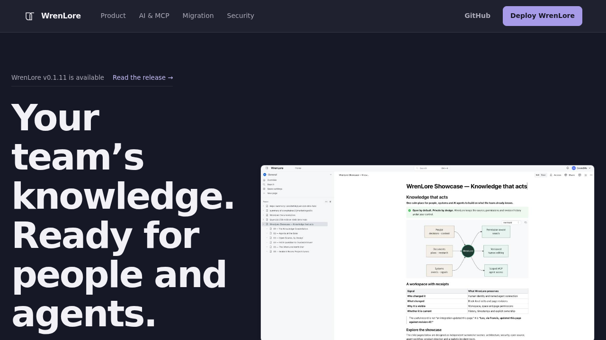
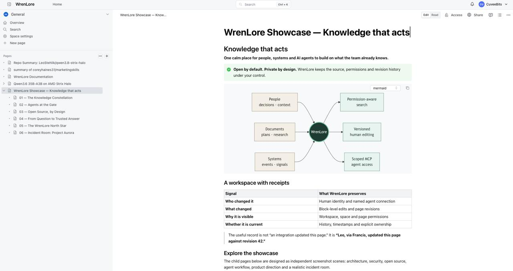
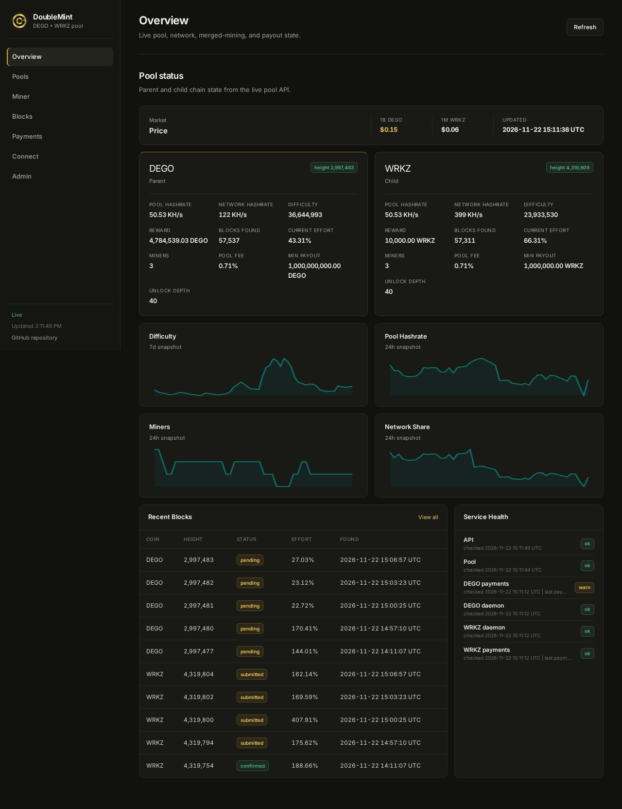

# Recent Work

These examples are included as proof of decisions that shipped. Copy the reasoning, not the colours or exact layout.

## WrenLore website

Live: https://wrenlore.com/

What worked:

- The product itself appears in the hero instead of an abstract illustration.
- Astro keeps the marketing and SEO pages static; React is available only for interactive primitives.
- The palette is quiet enough for long-form reading, with green used as a product accent rather than a glow effect.
- Real screenshots appear where they support a page claim, with explicit dimensions and responsive treatment.
- The page uses direct product language and lets the interface provide credibility.

Stack: Astro, React islands, Tailwind CSS v4, Base UI/coss conventions, Inter, Geist and Lucide.

## WrenLore product proof

The real workspace screenshot is more persuasive than a polished fake. It also exposes practical constraints that mockups hide: dense navigation, long page titles, tables, diagrams and user controls all need to remain legible.

## DoubleMint mining dashboard

Live: https://pool.derogold.online/

What worked:

- A stable sidebar, plain header and compact surfaces keep attention on live pool data.
- Parent and merged-mined child coins share one visual grammar without hiding their different roles.
- Trend cards use real stored history. There are no invented charts or vanity metrics.
- Status colours are sparse and semantic: green for healthy, gold for pending or warning, red for failure.
- Astro builds the shell while plain JavaScript handles the existing pool API. React was installed as an available island layer, not forced into a simple fetch/render screen.
- Desktop density remains useful while the sidebar and grids collapse cleanly on mobile.

Stack: Astro, Tailwind CSS v4, Base UI/coss conventions, plain JavaScript data rendering, Inter, Geist and Lucide.

## Reuse rule

Do not turn these screenshots into templates. Start from the new product's actual content, actions and constraints, then reuse the spacing discipline, component-choice order and verification standard.
